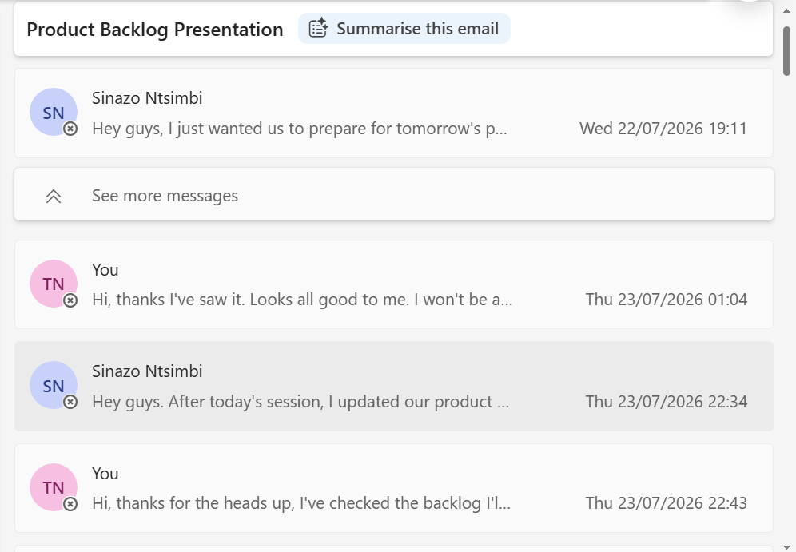
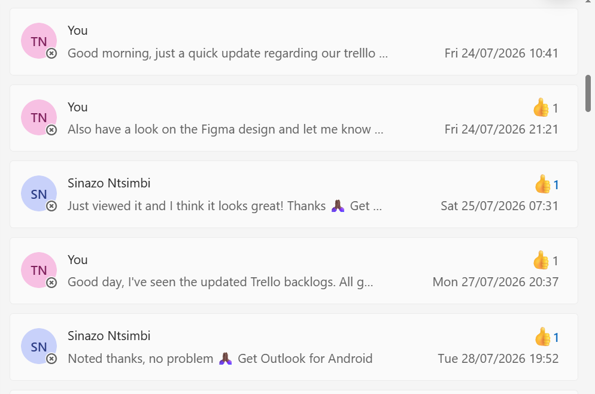
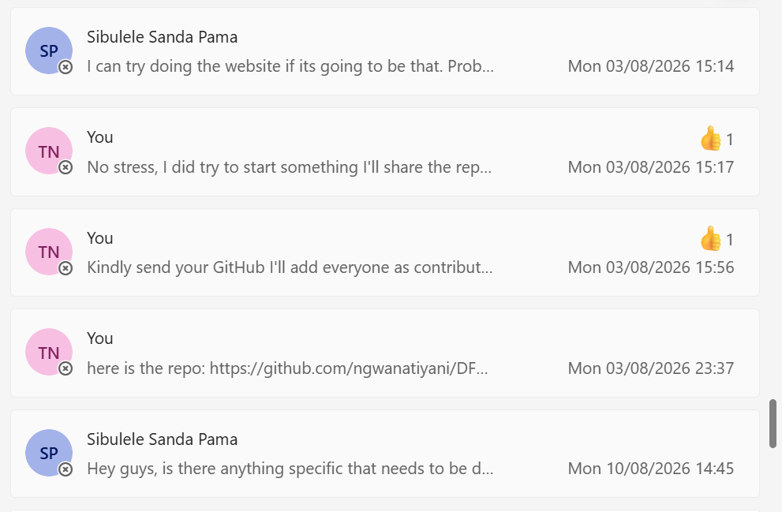

# Agile Team Charter Evidence

This page presents the completed **D6 Food Bulk Agile Team Charter** and supporting communication evidence. The screenshots are displayed at a compact size and can be selected to open at full resolution.

## 1. Completed Team Charter

The charter defines the team's purpose, roles, Kanban workflow, communication channels, working agreements, decision-making process, Definition of Done, risks and commitments.

- [**View completed charter online**](../assets/agile-team-charter/agile_team_charter.md)
- [**View original Word document**](https://view.officeapps.live.com/op/view.aspx?src=https%3A%2F%2Fraw.githubusercontent.com%2Fngwanatiyani%2Fngwanatiyani%2Fmain%2Fassets%2Fagile-team-charter%2Fagile_team_charter.docx)

## 2. Communication and Collaboration Evidence

The Outlook email records document how the team coordinated work between July and August 2026. They support the charter agreements on communication, transparency, feedback, shared planning and task ownership.

### 2.1 Product Backlog Preparation and Updates

  

<strong>Figure 1.</strong> Sinazo Ntsimbi and Tiyani Ngwana coordinate preparation and updates for the Product Backlog presentation, 22–23 July 2026. Select the image to view it at full size.

**Evidence shown:** The messages record advance preparation, review of shared work and follow-up after the team session.

### 2.2 Trello and Figma Review

  

<strong>Figure 2.</strong> Tiyani Ngwana and Sinazo Ntsimbi exchange updates about the Trello backlogs and Figma design, 24–28 July 2026. Select the image to view it at full size.

**Evidence shown:** The messages document visible Trello updates, a request for design feedback and acknowledgement of reviewed work.

### 2.3 Website and GitHub Collaboration

  

<strong>Figure 3.</strong> Sibulele Sanda Pama and Tiyani Ngwana discuss website work, repository sharing and contributor coordination, 3–10 August 2026. Select the image to view it at full size.

**Evidence shown:** The messages record website planning, repository access and coordination of team contributions through GitHub.

## 3. Evidence Alignment

The communication records support the following charter commitments:

- **Communication:** Outlook email was used for project updates, feedback and formal coordination.
- **Transparency:** Trello updates made backlog work and progress visible to the team.
- **Collaboration:** Team members reviewed work, exchanged feedback and coordinated website contributions.
- **Accountability:** Messages recorded follow-ups, acknowledgements and requests for specific action.
- **Shared tools:** The team used Outlook, Trello, Figma and GitHub to coordinate project work.
