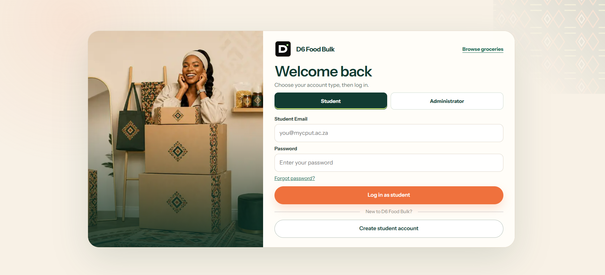
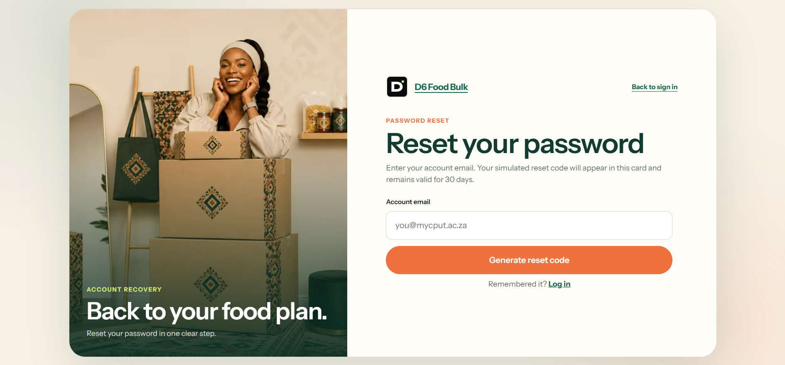

# User Stories and Tasks Evidence

User stories connected D6 Food Bulk features to clear student needs. The work below distinguishes the Sprint 1 authentication story from the additional business stories developed during the WIL project.

## Sprint 1 User Story — Registration & Authentication

> As a student, I want to create an account and log in securely so that I can access the D6 Food Bulk platform and place grocery orders.

### Task 1 — Design the Registration Page UI

**Purpose:** Provide a clear account-creation experience for CPUT students.

**Evidence shown:** The registration screen captures the student's name, surname, student number, year of study, residence, phone number, student email and password. It also provides a clear **Create account** action and a link for existing users to log in.

**Outcome supported:** Students can provide the account and residence information needed to access the platform and manage future orders.

 

### Task 2 — Implement User Login Functionality

**Purpose:** Give registered users a clear and secure entry point to the platform.

**Evidence shown:** The login screen provides student and administrator account options, student email and password fields, a **Log in as student** action, password-recovery navigation and a link to create a new account.

**Outcome supported:** The interface supports the user story by providing the expected sign-in journey. Functional authentication should also be demonstrated through testing or a working application flow.

 

### Task 3 — Create the User Profile Page

**Purpose:** Allow a signed-in student to view or manage relevant account information.

**Evidence status:** A user-profile screenshot has not yet been supplied. It should be added beside this task once available.

### Supporting Authentication Flow — Password Recovery

**Purpose:** Help a registered user recover access when a password is forgotten.

**Evidence shown:** The password-reset screen allows the user to enter an account email, generate a reset code and return to the login page. The interface states that the simulated reset code remains valid for 30 days.

**Outcome supported:** Password recovery strengthens the wider registration and authentication journey represented by the Sprint 1 user story.

 

## Additional User Stories

### Affordable and Customisable Orders

> As a student, I want affordable grocery bundles that I can customise according to my needs and budget.

The team identified bulk bundles, investigated grocery and supplier prices, and defined student discounts and the Bulk Wallet concept.

### Simple Ordering and Payment

> As a student, I want to place and pay for an order easily.

The ordering and payment steps were refined, and the Place and Pay process was mapped.

### Same-Day Residence Delivery

> As a student, I want same-day delivery to my residence.

The team investigated delivery costs and partners and proposed a R45 fee with a same-day delivery window.

### Safe Collection and Refunds

> As a student, I want a safe and traceable handover and the ability to request a refund when items are not in good condition.

Block Agent responsibilities, verified orders and safe handovers were defined, while the refund process required further clarification.

## Supporting Links

- [View the working D6 Food Bulk application](https://cptdfb.vercel.app/)
- [View the complete user stories and tasks on Trello](https://trello.com/invite/b/69f78ec09a27fa85efb7a81d/ATTI6dfcd3ac97b1d0ff578fd4b64024e3f2A65F99B8/d6-food-bulk)
- [View the Agile Logbooks](../05-agile-logbook/evidence.md)
