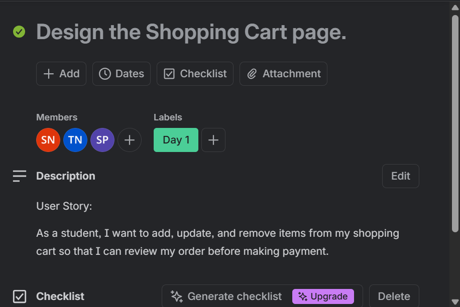
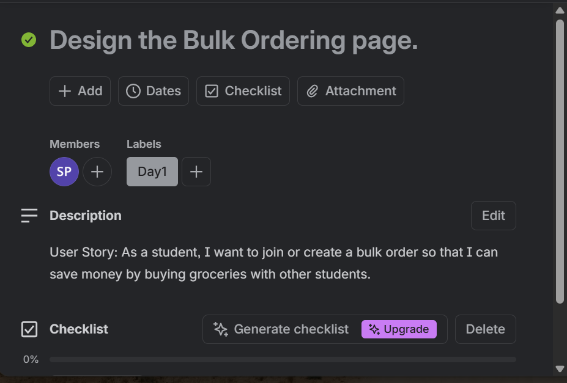
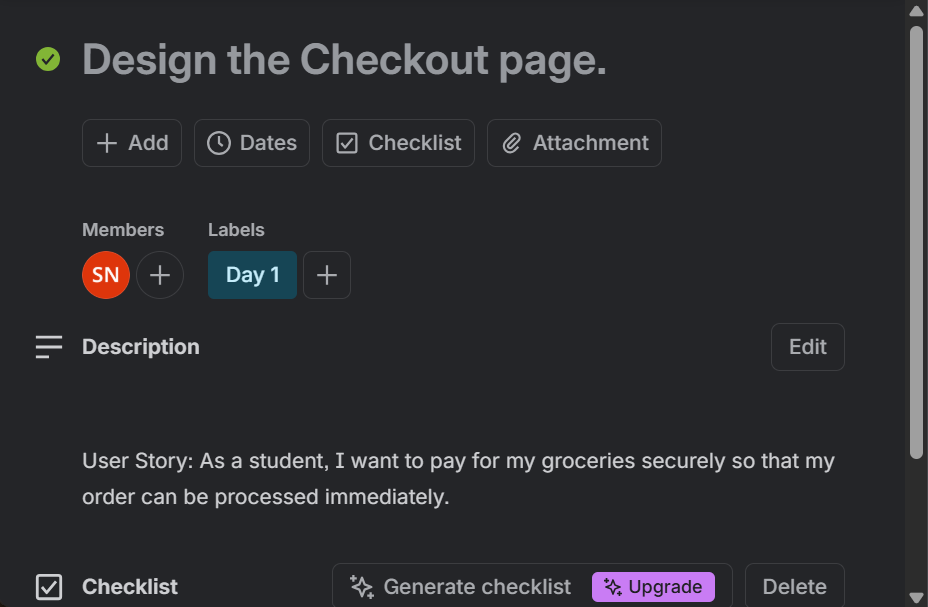

# User Stories Evidence

The following user stories describe the main student needs supported by D6 Food Bulk. Select any screenshot to view it at full size.

## 1. Registration and Authentication

> **User Story:** As a student, I want to create an account and log in securely so that I can access the D6 Food Bulk platform and place grocery orders.

  
  
  

Account registration · Secure login · Password recovery

## 2. Shopping Cart Management

> **User Story:** As a student, I want to add, update and remove items from my shopping cart so that I can review my order before making payment.

  

Trello evidence — Design the Shopping Cart page

## 3. Bulk Ordering

> **User Story:** As a student, I want to join or create a bulk order so that I can save money by buying groceries with other students.

  

Trello evidence — Design the Bulk Ordering page

## 4. Secure Checkout and Payment

> **User Story:** As a student, I want to pay for my groceries securely so that my order can be processed immediately.

  

Trello evidence — Design the Checkout page

## Trello Board

View the full set of user stories, descriptions and task cards on the public project board:

**[Open the D6 Food Bulk Trello Board](https://trello.com/invite/b/69f78ec09a27fa85efb7a81d/ATTI6dfcd3ac97b1d0ff578fd4b64024e3f2A65F99B8/d6-food-bulk)**
