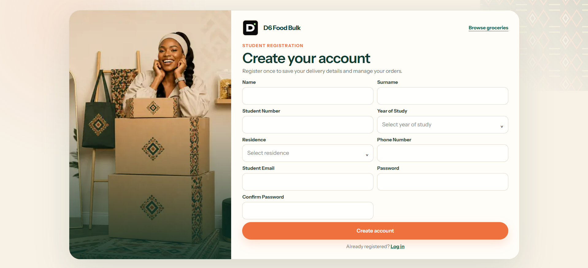
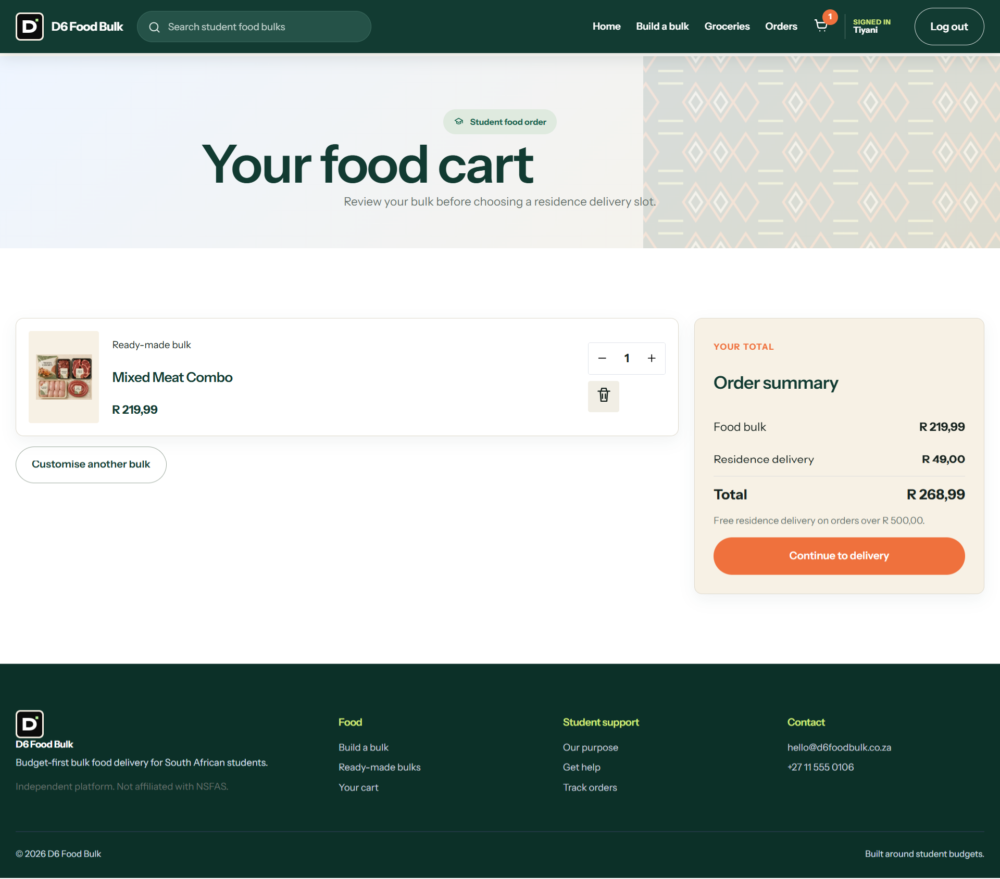
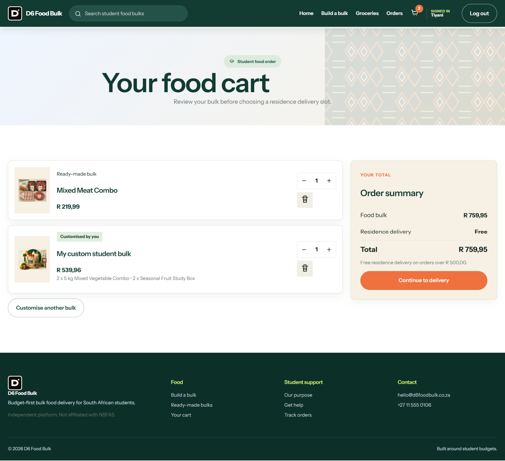
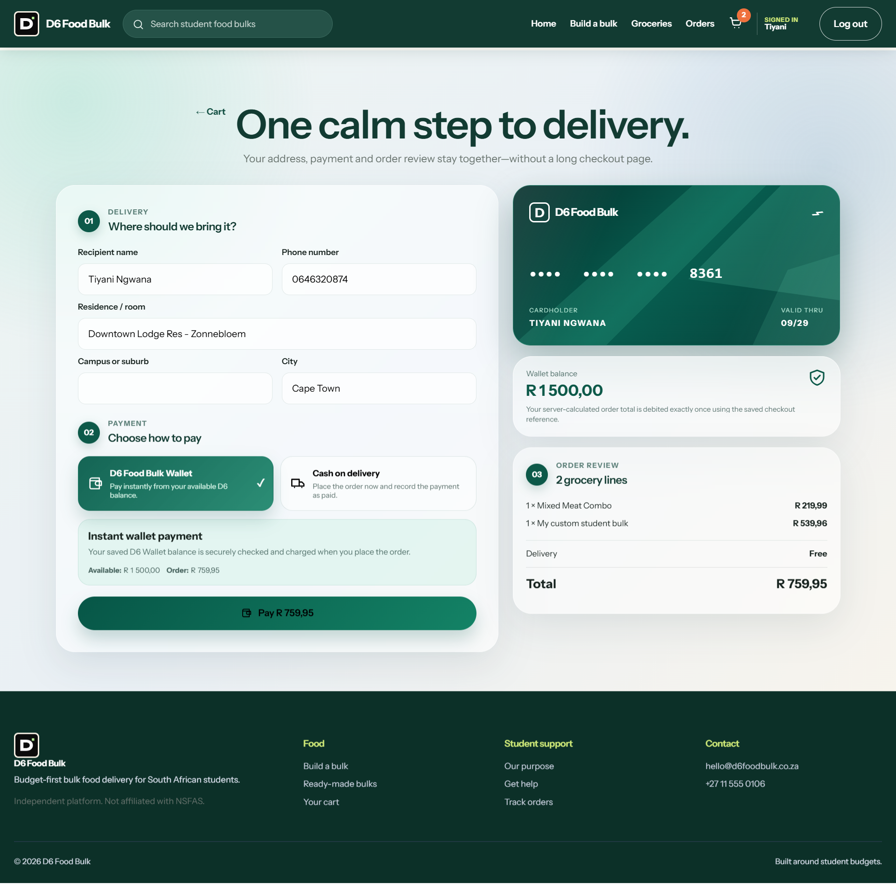

# User Stories and Tasks Evidence

Each user story is supported by a focused task breakdown and application evidence. Select any screenshot to view it at full size.

## 1. Registration and Authentication

> **User Story:** As a student, I want to create an account and log in securely so that I can access the D6 Food Bulk platform and place grocery orders.

### Tasks

- Design the student registration page.
- Capture and validate the required student account information.
- Implement student and administrator login options.
- Provide password-recovery navigation and a reset process.
- Create a student profile page for account information.

### Evidence Gallery

  
  
  

Account registration · Secure login · Password recovery

<strong><a href="https://trello.com/invite/b/69f78ec09a27fa85efb7a81d/ATTI6dfcd3ac97b1d0ff578fd4b64024e3f2A65F99B8/d6-food-bulk">View the related user story and tasks on Trello</a></strong>

---

## 2. Shopping Cart Management

> **User Story:** As a student, I want to add, update and remove items from my shopping cart so that I can review my order before making payment.

### Tasks

- Add selected grocery items and food bulks to the cart.
- Increase or decrease item quantities.
- Remove unwanted items from the cart.
- Recalculate the subtotal, delivery charge and order total.
- Provide navigation from the cart to the delivery step.

### Evidence

  

Cart quantity controls, item removal and order summary

<strong><a href="https://trello.com/invite/b/69f78ec09a27fa85efb7a81d/ATTI6dfcd3ac97b1d0ff578fd4b64024e3f2A65F99B8/d6-food-bulk">View the related user story and tasks on Trello</a></strong>

---

## 3. Bulk Ordering

> **User Story:** As a student, I want to join or create a bulk order so that I can save money by buying groceries with other students.

### Tasks

- Allow a student to create or customise a food bulk.
- Add ready-made and customised bulks to the same cart.
- Display the products included in a customised bulk.
- Update quantities or remove a bulk before checkout.
- Recalculate the combined bulk total and delivery charge.

### Evidence

  

Ready-made and customised student bulks reviewed together in the cart

<strong><a href="https://trello.com/invite/b/69f78ec09a27fa85efb7a81d/ATTI6dfcd3ac97b1d0ff578fd4b64024e3f2A65F99B8/d6-food-bulk">View the related user story and tasks on Trello</a></strong>

---

## 4. Secure Checkout and Payment

> **User Story:** As a student, I want to pay for my groceries securely so that my order can be processed immediately.

### Tasks

- Capture the recipient and residence-delivery details.
- Provide D6 Food Bulk Wallet and cash-on-delivery options.
- Display the available wallet balance and amount due.
- Present the grocery lines, delivery charge and final total for review.
- Process the selected payment method and submit the order.

### Evidence

  

Delivery details, payment method, wallet balance and final order review

<strong><a href="https://trello.com/invite/b/69f78ec09a27fa85efb7a81d/ATTI6dfcd3ac97b1d0ff578fd4b64024e3f2A65F99B8/d6-food-bulk">View the related user story and tasks on Trello</a></strong>

