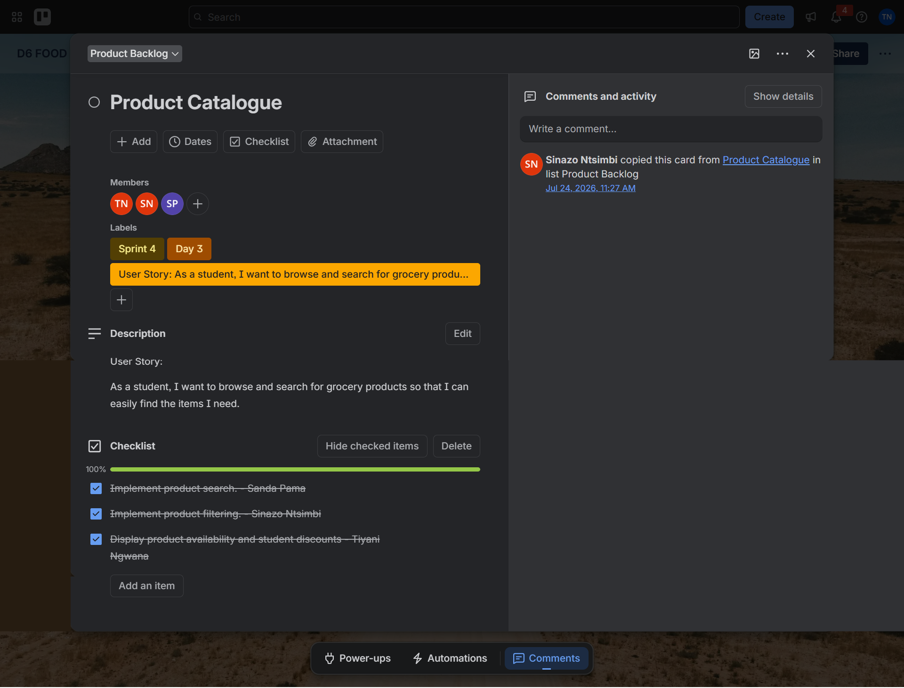
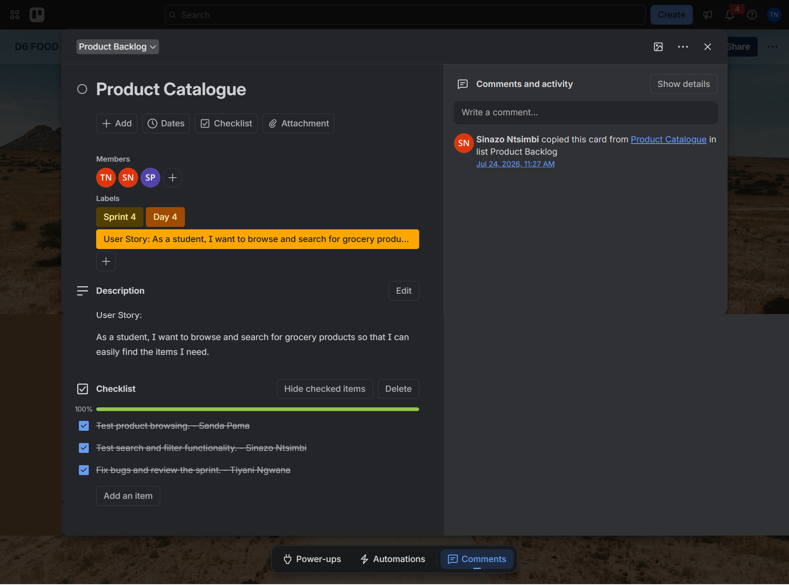

# Product Backlog Evidence

The Product Backlog records the work required to develop D6 Food Bulk. The Product Catalogue is a key backlog feature because students need to find suitable groceries before they can build a bulk order, review their cart or make payment.

## Product Catalogue

### User Story

> As a student, I want to browse and search for grocery products so that I can easily find the items I need.

### Backlog Objective

Provide a clear, searchable catalogue that displays grocery information, categories, availability and discounted student prices.

### Backlog Items

#### Catalogue Design

- Design the Product Catalogue page.
- Design the Product Details page.
- Design the product catalogue interface.
- Create grocery categories.

#### Product Data and Integration

- Design the product database.
- Add grocery products and categories to the database.
- Connect the catalogue to the database.
- Display product images and descriptions.

#### Search and Discovery

- Implement product search.
- Implement category filtering.
- Allow students to browse products efficiently.

#### Student Pricing and Availability

- Display student discount prices.
- Display product availability.
- Keep catalogue information clear enough to support purchasing decisions.

#### Testing and Review

- Test product browsing.
- Test search and filter functionality.
- Test catalogue loading performance.
- Fix identified bugs and review the completed work.

### My Assigned Contribution

The Trello checklists assign the following Product Catalogue tasks to **Tiyani Ngwana**:

- Design the product database.
- Connect the catalogue to the database.
- Display student discount prices.
- Display product availability.
- Test catalogue loading performance.
- Fix bugs and support the final review.

## Screenshot Evidence

The screenshots show the Product Catalogue user story and completed checklist items across four days. Select any image to view it at full size.

  
  

<strong>Day 1:</strong> Catalogue, product-details and database design · <strong>Day 2:</strong> Catalogue development, product data and database connection

  
  

<strong>Day 3:</strong> Search, filtering, availability and student discounts · <strong>Day 4:</strong> Browsing tests, search and filter tests, bug fixing and review

## Trello Evidence

- [Product Catalogue — design and database tasks](https://trello.com/c/CbJwEqPR/190-product-catalogue)
- [Product Catalogue — development and integration tasks](https://trello.com/c/SUCMkBHx/189-product-catalogue)
- [Product Catalogue — search, filtering and pricing tasks](https://trello.com/c/9RbyDtWp/188-product-catalogue)
- [Product Catalogue — testing and review tasks](https://trello.com/c/iidvc3Wi/187-product-catalogue)
- [Product Catalogue — consolidated backlog checklist](https://trello.com/c/U1xUQd76/186-product-catalogue)
- [View the complete D6 Food Bulk Product Backlog](https://trello.com/invite/b/69f78ec09a27fa85efb7a81d/ATTI6dfcd3ac97b1d0ff578fd4b64024e3f2A65F99B8/d6-food-bulk)
