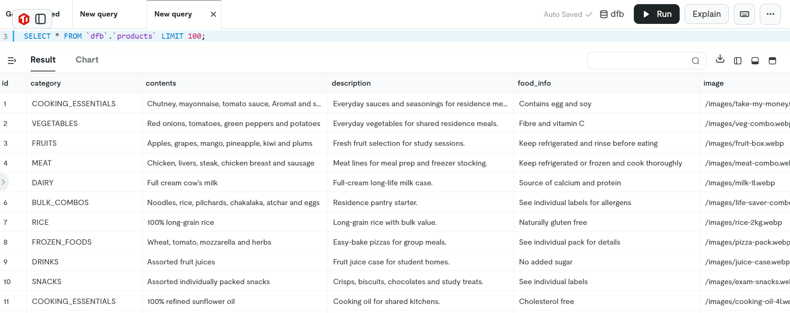
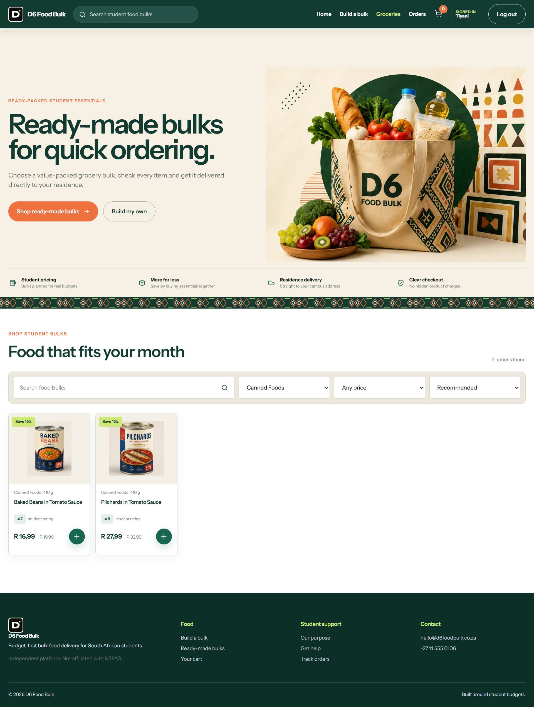
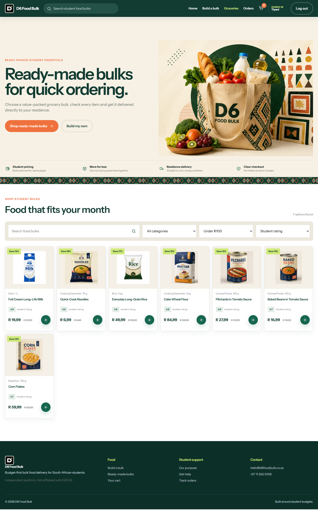
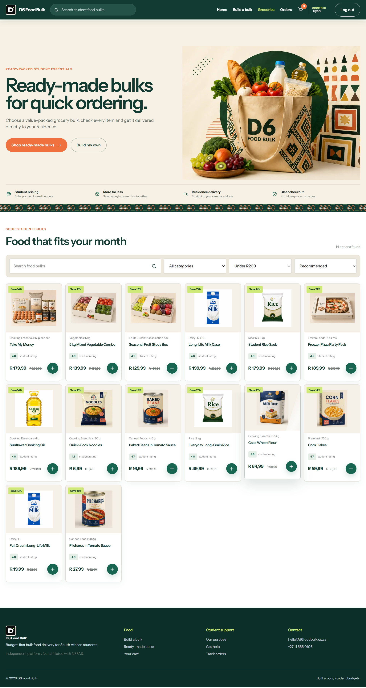
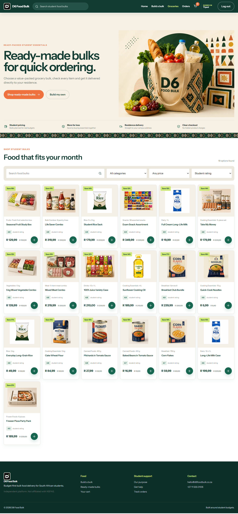

# Product Backlog Evidence

The Product Backlog records the work required to develop D6 Food Bulk. The Product Catalogue is a key backlog feature because students need to find suitable groceries before they can build a bulk order, review their cart or make payment.

## Product Catalogue

### User Story

> As a student, I want to browse and search for grocery products so that I can easily find the items I need.

### Backlog Objective

Provide a clear, searchable catalogue that displays grocery information, categories, availability and discounted student prices.

### Backlog Items

#### Catalogue Design

- Design the Product Catalogue page.
- Design the Product Details page.
- Design the product catalogue interface.
- Create grocery categories.

#### Product Data and Integration

- Design the product database.
- Add grocery products and categories to the database.
- Connect the catalogue to the database.
- Display product images and descriptions.

#### What Is TiDB?

[TiDB](https://docs.pingcap.com/tidbcloud/tidb-cloud-intro/) is an open-source, distributed SQL database. TiDB Cloud provides it as a managed database service, handling infrastructure, scaling and availability while the application works with standard SQL. It supports transactional application data and analytical queries in the same platform.

TiDB is also [highly compatible with the MySQL protocol](https://docs.pingcap.com/tidbcloud/mysql-compatibility/). This means an application can connect using common MySQL drivers and familiar SQL syntax instead of requiring a specialised database query language.

#### How TiDB Works

1. The application connects to TiDB using the MySQL-compatible connection protocol.
2. The application sends SQL statements such as `SELECT`, `INSERT`, `UPDATE` and `DELETE`.
3. TiDB processes the SQL request and reads or changes the distributed data.
4. The result is returned to the application for presentation to the user.
5. TiDB Cloud manages the underlying database infrastructure and can scale computing and storage as demand changes.

#### How D6 Food Bulk Uses TiDB

D6 Food Bulk uses TiDB as the central data source for the Product Catalogue:

- Product records are stored in the `dfb.products` table.
- Each record contains fields such as `id`, `category`, `contents`, `description`, `food_info` and `image`.
- The application layer retrieves these records for the website rather than storing catalogue content directly in the page.
- Retrieved data is used to display grocery and bulk options with their descriptions and food information.
- Categories support catalogue organisation and filtering.
- Image paths connect each database record to the correct product image shown by the interface.
- Products selected from the catalogue can then continue into the cart and checkout journey.

This approach keeps Product Catalogue information structured in one place and allows catalogue content to be updated without rewriting the interface.

#### TiDB Product Records

The screenshot shows the SQL query `SELECT * FROM dfb.products LIMIT 100;` and its results. It confirms that Product Catalogue records are available from the `dfb.products` table.

  

TiDB evidence — Product records stored in the <code>dfb.products</code> table

#### TiDB-Powered Frontend Catalogue

The product records retrieved from TiDB are displayed on the D6 Food Bulk catalogue. Because the data is structured, students can filter products by category, filter by price and sort by student rating. Select any image to view it at full size.

##### 1. Category Filter — Canned

  

Displays canned products retrieved from the TiDB catalogue.

##### 2. Price Filter — Under R100

  

Displays catalogue products priced below R100.

##### 3. Price Filter — Under R200

  

Displays catalogue products priced below R200.

##### 4. Sort by Student Rating

  

Sorts catalogue products according to their student ratings.

#### Search and Discovery

- Implement product search.
- Implement category filtering.
- Allow students to browse products efficiently.

#### Student Pricing and Availability

- Display student discount prices.
- Display product availability.
- Keep catalogue information clear enough to support purchasing decisions.

#### Testing and Review

- Test product browsing.
- Test search and filter functionality.
- Test catalogue loading performance.
- Fix identified bugs and review the completed work.

### My Assigned Contribution

The Trello checklists assign the following Product Catalogue tasks to **Tiyani Ngwana**:

- Design the product database.
- Connect the catalogue to the database.
- Display student discount prices.
- Display product availability.
- Test catalogue loading performance.
- Fix bugs and support the final review.

## Screenshot Evidence

The screenshots show the Product Catalogue user story and completed checklist items across four days. Select any image to view it at full size.

  
  

<strong>Day 1:</strong> Catalogue, product-details and database design · <strong>Day 2:</strong> Catalogue development, product data and database connection

  
  

<strong>Day 3:</strong> Search, filtering, availability and student discounts · <strong>Day 4:</strong> Browsing tests, search and filter tests, bug fixing and review

## Trello Evidence

- [Product Catalogue — design and database tasks](https://trello.com/c/CbJwEqPR/190-product-catalogue)
- [Product Catalogue — development and integration tasks](https://trello.com/c/SUCMkBHx/189-product-catalogue)
- [Product Catalogue — search, filtering and pricing tasks](https://trello.com/c/9RbyDtWp/188-product-catalogue)
- [Product Catalogue — testing and review tasks](https://trello.com/c/iidvc3Wi/187-product-catalogue)
- [Product Catalogue — consolidated backlog checklist](https://trello.com/c/U1xUQd76/186-product-catalogue)
- [View the complete D6 Food Bulk Product Backlog](https://trello.com/invite/b/69f78ec09a27fa85efb7a81d/ATTI6dfcd3ac97b1d0ff578fd4b64024e3f2A65F99B8/d6-food-bulk)
