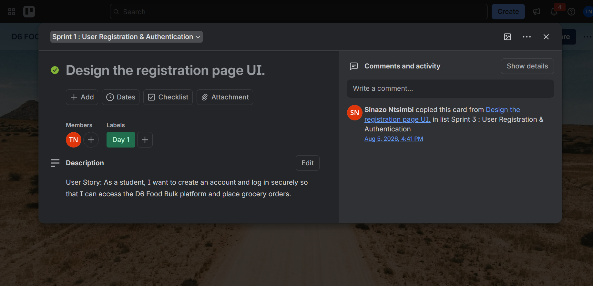
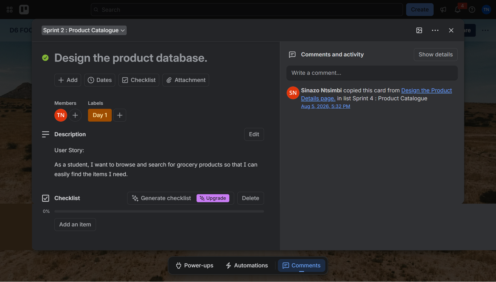
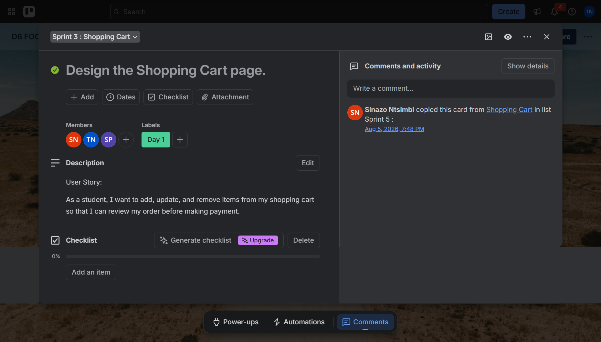
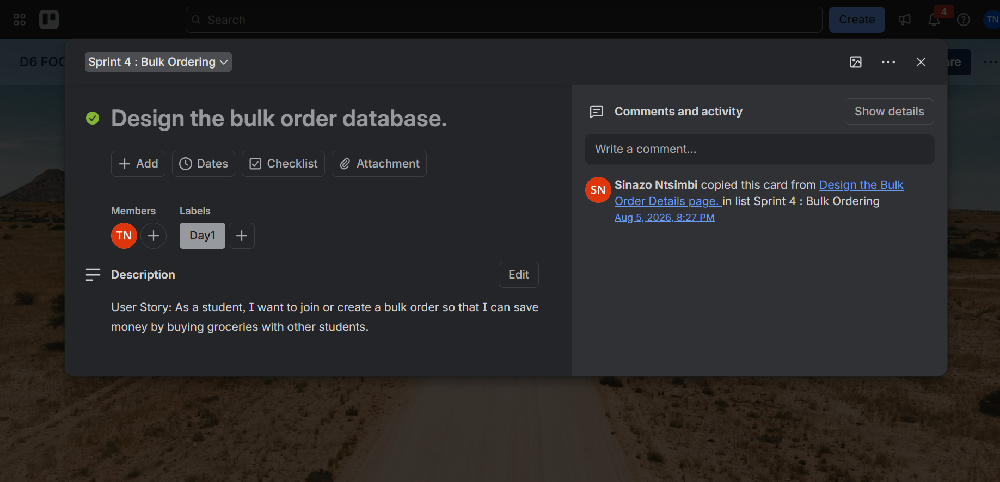
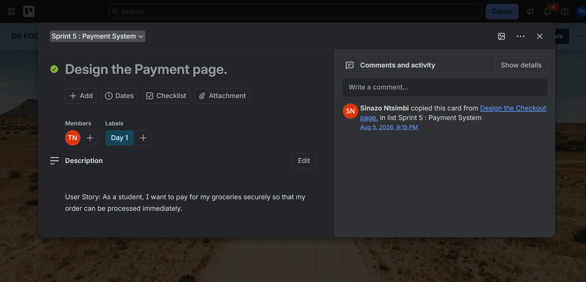

# Sprint Backlog Evidence

This Sprint Backlog records the work assigned to **Tiyani Ngwana** across Sprints 1–5 on the [D6 Food Bulk Trello board](https://trello.com/b/b3Akuvef/d6-food-bulk). Each task links directly to its Trello card.

## Sprint 1: User Registration & Authentication

**Sprint focus:** Establish secure student access through registration, login, profile management and password recovery.

> **User Story:** As a student, I want to create an account and log in securely so that I can access the D6 Food Bulk platform and place grocery orders.

### Trello Screenshot

  

Sprint 1 evidence — Registration page UI assigned to Tiyani Ngwana

**Direct Trello access:** [Open Sprint 1 on Trello](https://trello.com/c/cTQGadd8/219-design-the-registration-page-ui)

### My Assigned Tasks

- [Design the registration page UI](https://trello.com/c/cTQGadd8/219-design-the-registration-page-ui)
- [Develop the user registration functionality](https://trello.com/c/le7n5XRN/221-develop-the-user-registration-functionality)
- [Validate student email addresses during registration](https://trello.com/c/ss9yKc6Z/237-validate-student-email-addresses-during-registration)
- [Test product browsing](https://trello.com/c/hEUHQ9mp/224-test-product-browsing)

### Explanation and Evidence

My work focused on designing and developing student registration, validating student email addresses and completing the testing task assigned to me. The product-browsing test is listed because Trello currently assigns that card to me within Sprint 1. Registration evidence is available in the [User Stories evidence](../02-user-stories-and-tasks/evidence.md#1-registration-and-authentication).

---

## Sprint 2: Product Catalogue

**Sprint focus:** Build a database-driven catalogue where students can browse, search and filter groceries and view student pricing.

> **User Story:** As a student, I want to browse and search for grocery products so that I can easily find the items I need.

### Trello Screenshot

  

Sprint 2 evidence — Product database design assigned to Tiyani Ngwana

**Direct Trello access:** [Open Sprint 2 on Trello](https://trello.com/c/lrVjlW6S/232-design-the-product-database)

### My Assigned Tasks

- [Design the product database](https://trello.com/c/lrVjlW6S/232-design-the-product-database)
- [Connect the catalogue to the database](https://trello.com/c/fEs3nyI1/234-connect-the-catalogue-to-the-database)
- [Display product availability and student discounts](https://trello.com/c/FZeR2ykU/236-display-product-availability-and-student-discounts)
- [Fix bugs and review the sprint](https://trello.com/c/qvnt6gaJ/241-fix-bugs-and-review-the-sprint)

### Explanation and Evidence

My work connected the Product Catalogue to its database foundation, supported availability and student-discount information, and included final bug fixing and sprint review. The database and catalogue screenshots are documented in the [Product Backlog evidence](../03-product-backlog/evidence.md).

---

## Sprint 3: Shopping Cart

**Sprint focus:** Allow students to add, remove and update items, preserve their carts and review accurate totals before checkout.

> **User Story:** As a student, I want to add, update and remove items from my shopping cart so that I can review my order before making payment.

### Trello Screenshot

  

Sprint 3 evidence — Shopping Cart page design shared with Tiyani Ngwana

**Direct Trello access:** [Open Sprint 3 on Trello](https://trello.com/c/UUlCUr1e/242-design-the-shopping-cart-page)

### My Assigned Tasks

- [Design the Shopping Cart page](https://trello.com/c/UUlCUr1e/242-design-the-shopping-cart-page) — Shared team task
- [Design the Checkout Summary page](https://trello.com/c/bVP3vmhm/246-design-the-checkout-summary-page)
- [Connect the shopping cart to the database](https://trello.com/c/ZVI74XVm/249-connect-the-shopping-cart-to-the-database)
- [Save cart items before checkout](https://trello.com/c/IBFitOgb/251-save-cart-items-before-checkout)
- [Test total calculations](https://trello.com/c/C59ZUGiF/254-test-total-calculations)

### Explanation and Evidence

My work covered the shared Shopping Cart page design, Checkout Summary design, database connection, cart persistence and total-calculation testing. Together, these tasks supported the student's journey from selecting items to reviewing the order before payment. The interface is shown in the [Shopping Cart user-story evidence](../02-user-stories-and-tasks/evidence.md#2-shopping-cart-management).

---

## Sprint 4: Bulk Ordering

**Sprint focus:** Allow students to create or join shared grocery orders while tracking progress, contributions and deadlines.

> **User Story:** As a student, I want to join or create a bulk order so that I can save money by buying groceries with other students.

### Trello Screenshot

  

Sprint 4 evidence — Bulk order database design assigned to Tiyani Ngwana

**Direct Trello access:** [Open Sprint 4 on Trello](https://trello.com/c/TlpHRFWM/261-design-the-bulk-order-database)

### My Assigned Tasks

- [Design the bulk order database](https://trello.com/c/TlpHRFWM/261-design-the-bulk-order-database)
- [Connect bulk orders to the database](https://trello.com/c/rh0bxo3H/263-connect-bulk-orders-to-the-database)
- [Display bulk order deadlines](https://trello.com/c/50FrasEG/265-display-bulk-order-deadlines)
- [Fix bugs and conduct sprint review](https://trello.com/c/wX425S6z/267-fix-bugs-and-conduct-sprint-review)

### Explanation and Evidence

My work established the bulk-order database and its application connection, supported deadline visibility, and included bug fixing and sprint review. These tasks helped students manage time-sensitive shared grocery orders. The current interface is shown in the [Bulk Ordering user-story evidence](../02-user-stories-and-tasks/evidence.md#3-bulk-ordering).

---

## Sprint 5: Payment System

**Sprint focus:** Provide checkout, payment processing, transaction testing and payment-history support.

> **User Story:** As a student, I want to pay for my groceries securely so that my order can be processed immediately.

### Trello Screenshot

  

Sprint 5 evidence — Payment page design assigned to Tiyani Ngwana

**Direct Trello access:** [Open Sprint 5 on Trello](https://trello.com/c/bv55KrwT/272-design-the-payment-page)

### My Assigned Tasks

- [Design the Payment page](https://trello.com/c/bv55KrwT/272-design-the-payment-page)
- [Integrate the payment gateway](https://trello.com/c/v8vGPifW/274-integrate-the-payment-gateway)
- [Display payment history](https://trello.com/c/rWhPxna6/277-display-payment-history)
- [Test payment transactions](https://trello.com/c/TxeeRaih/278-test-payment-transactions)

### Explanation and Evidence

My work covered the Payment page design, payment-gateway integration, payment-history display and transaction testing. These tasks supported secure order payment and access to payment records. The current checkout interface is shown in the [Payment user-story evidence](../02-user-stories-and-tasks/evidence.md#4-secure-checkout-and-payment).

## Supporting Links

- [View the D6 Food Bulk application](https://cptdfb.vercel.app/)
- [View the complete Trello board](https://trello.com/b/b3Akuvef/d6-food-bulk)
- [View the User Stories evidence](../02-user-stories-and-tasks/evidence.md)
- [View the Product Backlog evidence](../03-product-backlog/evidence.md)
- [View the Agile Logbooks](../05-agile-logbook/evidence.md)
