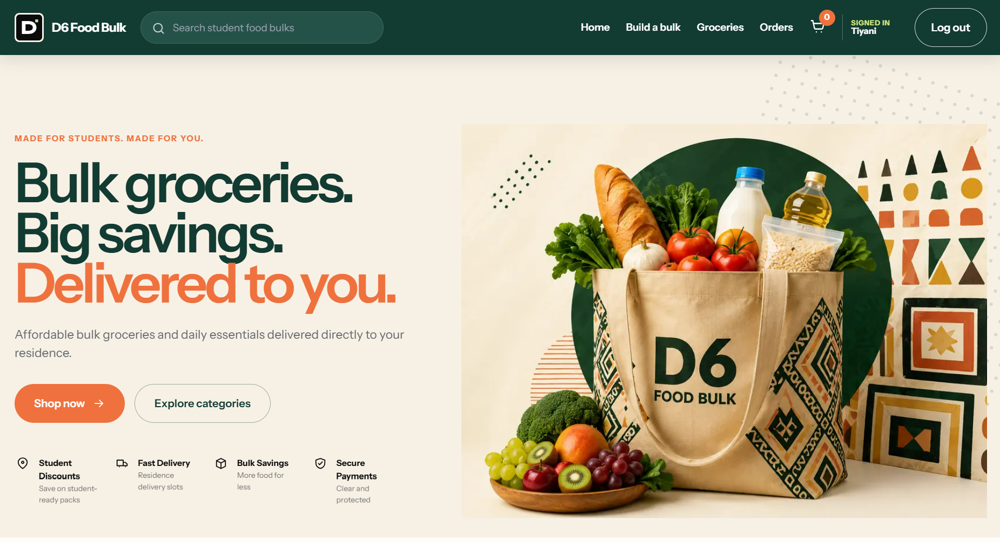

# Entrepreneurial WIL Digital Portfolio

## D6 Food Bulk

A portfolio of project evidence and STAR reflections for **Project Presentation 3 (PRP372S)**.

## Student Details

- **Name and Surname:** Tiyani Ngwana
- **Student Number:** 231266731
- **Institution:** Cape Peninsula University of Technology
- **Course:** Diploma in ICT Applications Development
- **Module:** Project Presentation 3
- **Module Code:** PRP372S

## Project Overview

This portfolio documents the Entrepreneurial Work-Integrated Learning project completed between 14 July and 30 October. The project involved developing a business concept, organising the work into manageable backlog items and sprints, and presenting progress throughout the development process.

Our team developed **D6 Food Bulk**, a platform designed to help NSFAS students access affordable groceries from wholesalers. Students can create customised food bulks according to their needs and budgets. The initial service area focuses on CPUT residences at the Cape Town Campus.

  

D6 Food Bulk homepage — affordable bulk groceries, student savings and residence delivery

## Technology Stack

### Application Development

-  **Java** — Implements the backend business logic and application services.
-  **Spring Boot** — Provides the backend framework used to build the application's REST services.
-  **React** — Builds the component-based frontend and interactive user interface.
-  **Spring Security** — Supports authentication, authorisation and protected application access.

### Data and Deployment

-  **TiDB** — Stores structured application and Product Catalogue data in a MySQL-compatible distributed SQL database.
-  **Vercel** — Deploys and serves the React frontend.
-  **Render** — Hosts and deploys the backend application services.

Technology logos sourced from [Simple Icons](https://simpleicons.org/) and [Devicon](https://devicon.dev/).

## Project Links

- **Live Application:** [D6 Food Bulk](https://cptdfb.vercel.app/)
- **Project Board:** [D6 Food Bulk on Trello](https://trello.com/invite/b/69f78ec09a27fa85efb7a81d/ATTI6dfcd3ac97b1d0ff578fd4b64024e3f2A65F99B8/d6-food-bulk)

## Portfolio Sections

###  1. Agile Team Charter

- [View Evidence](01-agile-team-charter/evidence.md)
- [Read STAR Reflection](01-agile-team-charter/reflection.md)

###  2. User Stories and Tasks

- [View Evidence](02-user-stories-and-tasks/evidence.md)
- [Read STAR Reflection](02-user-stories-and-tasks/reflection.md)

###  3. Product Backlog

- [View Evidence](03-product-backlog/evidence.md)
- [Read STAR Reflection](03-product-backlog/reflection.md)

###  4. Sprint Backlog

- [View Evidence](04-sprint-backlog/evidence.md)
- [Read STAR Reflection](04-sprint-backlog/reflection.md)

###  5. Agile Logbook

- [View Evidence](05-agile-logbook/evidence.md)
- [Read STAR Reflection](05-agile-logbook/reflection.md)
